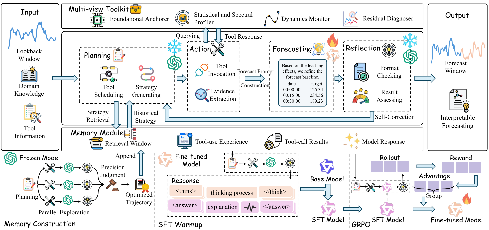

<div align="center">
  
  <h1>CastFlow</h1>
  <p><strong>Bridging Evidence Acquisition and Accurate Prediction in Agentic Time Series Forecasting</strong></p>
  <p>CastFlow is a role-specialized agentic workflow for time series forecasting. It couples a frozen general-purpose reasoning model for planning and reflection with a trainable local forecasting model for evidence-guided numerical refinement.</p>
  <p>
    <a href="https://arxiv.org/abs/2604.27840"><kbd><strong>arXiv</strong></kbd></a> &nbsp;
    <a href="https://forever-pan.github.io/CastFlow/assets/paper/CastFlow.pdf"><kbd><strong>Paper PDF</strong></kbd></a> &nbsp;
    <a href="https://forever-pan.github.io/CastFlow/"><kbd><strong>Project page</strong></kbd></a> &nbsp;
    <a href="#citation"><kbd><strong>Citation</strong></kbd></a>
  </p>
</div>

<p align="center">
  <a href="https://forever-pan.github.io/CastFlow/">
    
  </a>
</p>

---

## Start here

CastFlow pairs experience-guided evidence acquisition with a specialized numerical
forecaster. The paper reports the lowest MSE and MAE on 9 of 10 benchmarks among
21 competing methods. See the [results and comparison table](https://forever-pan.github.io/CastFlow/#results).

- **Read:** [paper PDF](https://forever-pan.github.io/CastFlow/assets/paper/CastFlow.pdf), [arXiv](https://arxiv.org/abs/2604.27840), and [project page](https://forever-pan.github.io/CastFlow/).
- **Set up:** [installation](#installation), [dataset placement](#dataset-placement), [weight placement](#weight-placement), and [task prompts](docs/PROMPTS.md).
- **Run:** [end-to-end workflow](#end-to-end-workflow) and [runtime configuration](docs/REPRODUCIBILITY.md).
- **Cite:** use the [BibTeX entry](#citation) or GitHub's **Cite this repository** panel.

### Quick environment check

```bash
git clone https://github.com/Forever-Pan/CastFlow.git
cd CastFlow
python -m pip install -e .
python -m cli --help
```

This installs the core CLI. To run forecasting, continue with the optional
dependencies, input data, expert and forecasting weights, and two model endpoints
described below.

## Workflow Overview 🔁

The public implementation exposes the following forecasting roles. SFT and RLVR update only the forecasting model; planning and reflection remain frozen:

| Component | Workflow |
| --- | --- |
| **Planning** | Select diagnostic tools using a frozen external LLM. |
| **Action** | Execute the multi-view toolkit and build an ensemble forecast baseline. |
| **Forecasting** | Use a fine-tuned local LLM to refine the baseline into a numerical forecast. |
| **Reflection** | Validate output structure and evidence alignment, then retry if needed. |
| **Strategy Memory** | Retrieve successful historical tool-use trajectories. |
| **Foundational Anchorer** | Retrieve similar historical cases and ensemble classical, deep, and foundation time-series models. |

## Directory Layout 🗂️

```text
CastFlow/
  cli/                              CLI entry package (`python -m cli` / `castflow`)
  scripts/                          Bash wrappers for the end-to-end workflow
  utils/                            Runtime config, dataset registry/io, schema, and shared helpers
  evaluation/                       Forecast parsing and metric evaluation
  forecasting/                      Prompting, tool execution, and inference modules
  workflow/                         End-to-end workflow orchestration and strategy memory
  training/                         SFT, RLVR, reward, and export utilities
  anchorer/                         Foundational Anchorer case-library construction
  backends/                         External time-series model runtime
  docs/                             Project page assets
  assets/                           Repository figures
```

<a id="dataset-placement"></a>

## Dataset Placement 📊

Prepare the benchmark CSVs using the reported chronological 7:1:2 split before
running the workflow. The registry reads these files and uses the following
lookback/horizon/stride settings; it does not create the splits automatically.

| Dataset | Train CSV | Test CSV | Lookback | Horizon | Stride |
| --- | --- | --- | ---: | ---: | ---: |
| BE | `data/raw/train/EPF_BE_train_val.csv` | `data/raw/test/EPF_BE_test.csv` | 168 | 24 | 48 |
| DE | `data/raw/train/EPF_DE_train_val.csv` | `data/raw/test/EPF_DE_test.csv` | 168 | 24 | 48 |
| FR | `data/raw/train/EPF_FR_train_val.csv` | `data/raw/test/EPF_FR_test.csv` | 168 | 24 | 48 |
| NP | `data/raw/train/EPF_NP_train_val.csv` | `data/raw/test/EPF_NP_test.csv` | 168 | 24 | 48 |
| PJM | `data/raw/train/EPF_PJM_train_val.csv` | `data/raw/test/EPF_PJM_test.csv` | 168 | 24 | 48 |
| ETTh | `data/raw/train/ETT_ETTh1_train_val.csv` | `data/raw/test/ETT_ETTh1_test.csv` | 96 | 96 | 48 |
| ETTm | `data/raw/train/ETT_ETTm1_train_val.csv` | `data/raw/test/ETT_ETTm1_test.csv` | 96 | 96 | 96 |
| WP | `data/raw/train/windy_power_train_val.csv` | `data/raw/test/windy_power_test.csv` | 96 | 96 | 96 |
| SP | `data/raw/train/sunny_power_train_val.csv` | `data/raw/test/sunny_power_test.csv` | 96 | 96 | 96 |
| MOPEX | `data/raw/train/mopex_train_val.csv` | `data/raw/test/mopex_test.csv` | 96 | 96 | 48 |

ETTh and ETTm are the manuscript display names. The CLI and file registry use
`ETTh1` and `ETTm1` as their corresponding identifiers.

CSV files should contain one timestamp column named `date` or `time_stamp`. If no timestamp column exists, CastFlow uses the row index. The target column defaults to the last numeric non-timestamp column; use `--target-col` if you need to override it.

<a id="weight-placement"></a>

## Weight Placement 🧠

### Local Forecasting LLM

Place the trainable local model somewhere accessible, for example:

```text
../models/Qwen3-4B
```

The configuration uses **Qwen3-4B** as the local trainable forecasting backbone.

### Foundational Anchorer Runtime

`backends/` provides named expert adapters and an explicit model catalog. Keep
model assets outside the source checkout, for example:

```text
../castflow_runtime/models/ChronosTiny/
```

The initializer prepares reusable expert recipes, validates requested local
weights, and saves the selected parameters with each library. It stops on a
missing selected expert instead of silently changing the ensemble. Native
statistical experts fit on each lookback and do not require pretrained weights.
Run `python -m cli initialize --list-models` to inspect the choices. Additional
local deep or foundation models can use an explicit `module:callable` adapter
in the expert manifest consumed by `build-anchorer`.

## Environment 💻

The workflow scripts target Linux with Python 3.10 or 3.11. Training and local
model serving additionally require a compatible GPU/CUDA environment.

```bash
git clone https://github.com/Forever-Pan/CastFlow.git
cd CastFlow
```

## Requirements 📦

| Package | Version / use |
| --- | --- |
| Python | `>=3.10` |
| `numpy`, `pandas` | core data handling |
| `openai` | Planning, Reflection, and OpenAI-compatible inference |
| `tqdm` | progress display for long-running workflows |
| `python-dateutil`, `holidays` | time-series calendar utilities |
| `statsmodels`, `dtaidistance` | statistical experts and case distances |
| PyTorch | `>=2.1`, for SFT |
| `transformers` | `>=4.51.0`, required for Qwen3 support |
| `datasets` | `>=2.14` |
| `peft` | `>=0.6` |
| `accelerate`, `deepspeed` | distributed SFT |
| `einops`, `safetensors` | deep learning / model loading |
| `pyarrow` | `>=12`, RL parquet I/O |
| `agentlightning==0.3.0`, `verl==0.6.1` | RLVR |
| `flash-attn>=2.6.3,<3` | RL actor attention; match the PyTorch/CUDA environment |
| `vllm==0.10.2` | rollout and local forecasting serving |
| `chronos-forecasting`, `xgboost`, `lightgbm` | optional named expert adapters |

The package metadata in `pyproject.toml` already defines the core, anchorer, training, RLVR, and serving dependency groups.

<a id="installation"></a>

## Installation ⚙️

Install the core package, then add the components needed for your run:

```bash
python -m pip install -e .
python -m cli --help
# Native experts and one-command initialization:
python -m pip install -e '.[initialization]'
# Balanced statistical, neural, and foundation case-bank pool:
python -m pip install -e '.[casebank]'
# Optional expert-model pool:
python -m pip install -e '.[anchorer]'
# Optional SFT:
python -m pip install -e '.[training]'
# Use an environment with a compatible PyTorch/CUDA stack for serving:
python -m pip install -e '.[serving]'
```

`requirements.txt` lists the combined dependency set. The optional groups let
you install only the components you need.

For RLVR, first prepare a PyTorch/CUDA environment compatible with the pinned
vLLM and VERL stack. Install a
matching FlashAttention 2 wheel, or build it against that environment before
installing the RLVR group:

```bash
python -m pip install --no-build-isolation 'flash-attn>=2.6.3,<3'
python -m pip install -e '.[training,rlvr]'
```

Source builds require a compatible CUDA compiler and build tools. Wheels must
match the Python, PyTorch, CUDA, and binary ABI in use. GPU memory requirements
also depend on context length, rollout groups, batch sizes, and optimizer state.
If dependency resolution replaces PyTorch, install the matching FlashAttention
build again.

Create a private configuration from the credential-free template:

```bash
cp .env.example .env
```

Set the planning/reflection endpoint, credential, and model name in `.env`.
The forecasting endpoint must point to your separately served trained model.
The forecasting completion limit defaults to 5,000 tokens. See
[runtime and reproducibility notes](docs/REPRODUCIBILITY.md) for configuration,
required external assets, and the scope of this public implementation.

### Task prompts

The packaged [reference templates](forecasting/reference_prompts) are newly
written, generic interface examples. They are not the operational prompts used
for the paper's experiments. Design the instructions for your own task and keep
the customized pack outside the checkout:

```bash
mkdir -p ../castflow_private/prompts
cp forecasting/reference_prompts/*.txt ../castflow_private/prompts/
# Edit the private copies for your task, then select that directory:
export CASTFLOW_PROMPT_DIR="$(cd ../castflow_private/prompts && pwd)"
```

The workflow also accepts `--prompt-dir /absolute/path/to/private/prompts`.
Without an override, it uses the generic reference pack. See
[prompt roles and customization](docs/PROMPTS.md) for the file contract and
handling of rendered prompts in generated artifacts.

## Default Parameters 🎛️

The table below describes public-code defaults and example-script settings.
They do not identify a particular historical experiment run.

| Component | Setting |
| --- | --- |
| Frozen planner/reflection model | Configure the endpoint and model explicitly; the manuscript uses Grok 4 |
| Local trainable forecaster | Qwen3-4B |
| Memory construction | K-parallel exploration, `PARALLEL_PLAN_K=4` |
| Memory retrieval | top-k memory retrieval, default `K=3`, threshold `0.90` |
| Reflection retries | initial attempt plus up to `3` training-side or `10` inference retries |
| SFT | cross-domain, 1 epoch, learning rate `5e-5`, global batch size 8 |
| RLVR | GRPO, group size `G=8`, temperature `1.0`, learning rate `2e-6`, KL coefficient `0.0`, 3 epochs |
| Forecast output length | 5,000 tokens |

## CLI Usage 🖥️

Workflow commands are implemented in `cli/cli.py`. From the repository root:

```bash
python -m cli --help
```

After `pip install -e .`, the same interface is available as `castflow`.

The numbered scripts in `scripts/` wrap these commands with the default cross-domain paths used below. Most scripts forward extra flags via `"$@"`; training and serving scripts also honor environment variables such as `BASE_MODEL_PATH`, `SFT_OUTPUT_DIR`, and `LOCAL_FORECAST_MODEL_PATH`.

<a id="end-to-end-workflow"></a>

## End-to-End Workflow 🚀

### One-command initialization

After placing training CSVs, configuring the frozen teacher endpoint in
`.env`, and selecting your task-specific prompt pack, build the expert libraries
and cross-domain experience memory together:

```bash
python -m pip install -e '.[casebank]'
bash scripts/00_initialize.sh --datasets BE,ETTh,WP --expert-preset balanced --promotion-policy conservative --download-models
```

This command checks every input before preparation, prepares the selected
experts, attempts up to 64 distinct parameter candidates per tunable expert,
retains the valid original recipe plus up to three prediction-distinct tuned
variants per family, constructs the anchor libraries, and checks each frozen
prior on a reserved chronological confirmation interval before exploring teacher
trajectories. The balanced preset combines SeasonalNaive, HistoricAverage,
AutoARIMA, Theta, Ridge, fresh prefix-trained DLinear variants, and frozen Chronos-Bolt Base.
Omit the preset for the original four native experts, or choose `--models`.
Candidate models may be excluded according to task requirements by listing only
the desired models with `--models`.
Model fitting, recipe selection, historical-loss calibration, and confirmation
use separate chronological intervals. Case caps sample across eligible history.
Stored cases and experience trajectories exclude the final training-side targets.
Calibrated historical validation losses enter `softmax(-L)`; one variant per
family is active in each cluster, so adding copies cannot increase its weight.
The default quality gate requires at least four complete calibration and four
complete confirmation windows, at least 1% lower MSE than the fixed seasonal
baseline (subject to the documented zero-error numerical tolerance), no MSE regression against
the untuned incumbent selected before confirmation, and no MAE regression against
either reference. An unsuccessful gate stops the full initialization before
teacher calls. `--quality-policy report` explicitly prepares a diagnostic bundle
whose qualification status remains visible.
By default, `--promotion-policy none` evaluates the exact frozen prepared prior.
The recommended `conservative` option first freezes the prepared ensemble, the
default model chosen on calibration data, and the original selection incumbent.
It selects a qualified global policy using the same strict criteria on the
training-side tail. That tail participates in policy selection, so its report
explicitly does not claim independent test performance. A separate test split
must remain outside initialization. No qualified policy means no promotion.
The teacher endpoint is used for trajectory generation; a trained local 4B
checkpoint is prepared and served separately in the training steps below.
Training memory uses the prepared prior; inference uses the selected policy.
Both paths and their roles are returned. A promoted policy requires dated
inputs and rejects requests before the last target used to select it.
The command prints concise library, memory, and diagnostic paths. By default, runtime
files are written under `../castflow_runtime/initialization` and reusable model
assets under `../castflow_runtime/models`, outside the source checkout.

```bash
# Inspect choices without creating assets or calling models:
python -m cli initialize --list-models
# Select experts and increase the distinct-candidate budget:
bash scripts/00_initialize.sh --datasets BE --models SeasonalNaive,HistoricAverage,Ridge --tuning-rounds 64
# Use local balanced assets on an explicitly selected GPU:
bash scripts/00_initialize.sh --datasets BE,WP --expert-preset balanced --promotion-policy conservative --model-device cuda:0 --anchors-only
# Prepare expert cases without teacher calls:
bash scripts/00_initialize.sh --datasets BE --anchors-only
# Custom input with explicit dimensions:
bash scripts/00_initialize.sh --data /path/train.csv --name custom --target-col value --timestamp-col date --lookback 96 --horizon 24 --seasonal-period 24
```

The same command resumes compatible completed stages and validates their hashes.
Searches report attempted, successful, and failed recipes, plus finite-space
exhaustion. A model with no tunable parameters is not counted as repeated trials.
The default stage boundaries are 60% for the fresh neural fit cutoff, 75% for
recipe selection, 82.5% for loss calibration, and 90% for confirmation. Each
scoring stage uses up to 24 complete, non-overlapping target windows on the
dataset's original stride grid. DLinear
case targets start after its fit cutoff. Frozen medoids precede selection;
later references do not change their geometry or calibrated weights. These are
initialization settings, rather than a claim to reconstruct historical runs.
Changed data, models, parameters, or source create a distinct initialization
identity. Use `--output-root` and `--model-store` to choose storage locations.
Pretrained expert weights are loaded locally; `--download-models` explicitly
permits downloading missing selected weights. See the
[runtime notes](docs/REPRODUCIBILITY.md) for custom dataset manifests and use of
the resulting bundle. The individual commands remain available below.

### Individual stages

Run the steps below from the repository root in order, or use the libraries and
memory paths printed by `initialize` to continue at the export stage.

<details open>
<summary><strong>1. Build The Foundational Anchorer Case Libraries</strong></summary>

Scans all registered train splits and writes one case library per domain.

```bash
bash scripts/01_build_anchorer.sh
```

Outputs:

```text
case_library/EPF_BE/anchor_library.json
case_library/EPF_DE/anchor_library.json
case_library/EPF_FR/anchor_library.json
case_library/EPF_NP/anchor_library.json
case_library/EPF_PJM/anchor_library.json
case_library/ETT_ETTh1/anchor_library.json
case_library/ETT_ETTm1/anchor_library.json
case_library/windy_power/anchor_library.json
case_library/sunny_power/anchor_library.json
case_library/mopex/anchor_library.json
```

For a small initial run, append `--max-windows 5`. This still executes the expert
models and writes a case library.

</details>

<details open>
<summary><strong>2. Build Cross-Domain Strategy Memory</strong></summary>

Loops over all registered train splits and uses the matching `case_library/*/anchor_library.json`.

```bash
bash scripts/02_build_memory.sh
```

Output: `memory/cross_domain/memory.json`

</details>

<details open>
<summary><strong>3. Export SFT Data From Memory</strong></summary>

```bash
bash scripts/03_export_sft.sh
```

Output: `data/sft/cross_domain_sft.csv`

</details>

<details open>
<summary><strong>4. Supervised Fine-Tuning</strong></summary>

Paper-style target: Qwen3-4B, 1 epoch, learning rate `5e-5`, global batch size 8.

```bash
bash scripts/04_train_sft.sh
```

Defaults: base model `../models/Qwen3-4B`, output `models/sft_cross_domain`, `max-length 14000`. Override with `BASE_MODEL_PATH`, `SFT_OUTPUT_DIR`, `NPROC_PER_NODE`, or `MASTER_PORT`.

</details>

<details open>
<summary><strong>5. Prepare RL Data</strong></summary>

```bash
bash scripts/05_prepare_rl.sh
```

Output: `data/rl/cross_domain_rl.parquet`. RL records retain true future labels
and the matched ensemble prior; teacher responses are not used as labels.

</details>

<details open>
<summary><strong>6. RL Training</strong></summary>

```bash
bash scripts/06_train_rlvr.sh
```

RLVR uses the pinned CUDA backend on Ampere or newer GPUs with BF16 support.
The actor retains FP32 master parameters and optimizer state while using BF16
mixed-precision computation; the reference model uses BF16. Optimizer states
are offloaded to CPU between updates, trading host RAM and transfer overhead
for GPU memory headroom. Provision memory
for the selected context and batch settings rather than GPU count alone.
Supply a separate held-out training-side validation parquet through
`RL_VALIDATION_PATH`; its prompts must not overlap the training prompts.
Output: `models/rl_cross_domain/`.

</details>

<details open>
<summary><strong>7. Serve The Local Forecasting Model</strong></summary>

Start vLLM before forecasting. The served model name must match `LOCAL_MODEL_NAME` in `.env`.

```bash
bash scripts/07_serve_local_forecaster.sh
```

By default this resolves the latest complete RL actor Hugging Face export under
`models/rl_cross_domain` and serves it on port `8002`. Set
`LOCAL_FORECAST_MODEL_PATH` to select another complete checkpoint explicitly.

</details>

<details open>
<summary><strong>8. Forecast A Test CSV</strong></summary>

Forecasting requires an explicit test CSV via `--data`. For registered benchmark filenames such as `EPF_DE_test.csv` and `windy_power_test.csv`, CastFlow automatically infers lookback, horizon, seasonal period, and stride from the file path.

DE example:

```bash
bash scripts/08_forecast_de.sh
```

Output: `predictions/de_forecast.csv`

</details>

<details open>
<summary><strong>9. Evaluate Forecasts</strong></summary>

DE example:

```bash
bash scripts/09_evaluate_de.sh
```

Prints aggregate MSE/MAE and writes `predictions/de_metrics.csv`.

</details>

<a id="citation"></a>

## Citation 📖

If you use CastFlow in your research, please cite the paper below.
The [project page](https://forever-pan.github.io/CastFlow/) provides the current
manuscript and figures. The [arXiv record](https://arxiv.org/abs/2604.27840)
preserves the preprint's version history.

```bibtex
@misc{pan2026castflow,
  title         = {CastFlow: Bridging Evidence Acquisition and Accurate Prediction in Agentic Time Series Forecasting},
  author        = {Pan, Bokai and Cheng, Mingyue and Tao, Xiaoyu and Liu, Zhiding and Yu, Shuo and Wu, Yuchong and Liu, Qi and Lian, Defu and Chen, Enhong},
  year          = {2026},
  eprint        = {2604.27840},
  archivePrefix = {arXiv},
  primaryClass  = {cs.LG},
  doi           = {10.48550/arXiv.2604.27840},
  url           = {https://arxiv.org/abs/2604.27840}
}
```

[Download BibTeX](docs/assets/citation.bib). Data, weights, and generated
case/memory libraries are described in [the runtime notes](docs/REPRODUCIBILITY.md).
